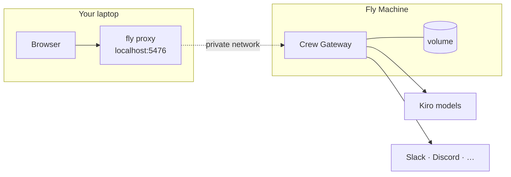

# crewfly

Run a [Kiro Crew](https://kiro.dev/docs/crew/) Gateway on [Fly.io](https://fly.io).

## Quickstart

Needs [`flyctl`](https://fly.io/docs/flyctl/install/) (logged in) and a Kiro account.

```bash
git clone https://github.com/metcalfc/crewfly && cd crewfly
./launch.sh
```

1. Fly builds and starts the gateway.
2. You approve a Kiro sign-in code in your browser.
3. The dashboard opens at `localhost:5476`.

Options:

- Choose where it runs: `./launch.sh --org ORG --region iad --name NAME`
- No sign-in prompt: `KIRO_API_KEY=... ./launch.sh`

## What it is



- **Always on.** One Machine that never auto-stops, so crons and channels keep working.
- **Private.** No public IP. The dashboard needs your Fly private network and a login link.
- **Persistent.** Sign-in, memory, agents and workspaces live on a volume with 14 days of snapshots.
- **Sized for sessions.** 8 shared vCPU, 16 GB RAM, 20 GB disk that grows to 100 GB.

## Run it

| Task | Command |
|---|---|
| Open the dashboard | `./dashboard.sh` |
| Connect Slack | `fly secrets set SLACK_BOT_TOKEN=... SLACK_APP_TOKEN=... KIROCREW_OWNER_ID=...` |
| Logs | `fly logs` |
| Shell | `fly ssh console -u kirocrew` |
| Run a Crew command | `fly ssh console -u kirocrew -C "kirocrew doctor"` |
| Upgrade Crew | `fly deploy` |
| Pin a Crew version | `fly deploy --build-arg KIROCREW_TAG=0.7.2` |
| Resize | `fly scale vm performance-4x --vm-memory 16384` |
| Delete everything | `fly apps destroy APP` |

- Always pass `-u kirocrew` to `fly ssh console`. Root sees none of Crew's state.
- A deploy or restart means a short outage. Crew does not replay crons missed while down.

## Limits

- Inbound webhooks are not reachable.
- One Machine, no HA.
- No voice input.

## Kiro docs

- [Kiro Crew](https://kiro.dev/docs/crew/): what Crew is and how to use it
- [Kiro CLI](https://kiro.dev/docs/cli/): the agent runtime and its sign-in
- [Docker guide](https://github.com/kirodotdev/KiroCrew/blob/main/docs/guides/docker.md): image tags, environment variables, sandbox
- [Docker troubleshooting](https://github.com/kirodotdev/KiroCrew/blob/main/docs/guides/docker-troubleshooting.md)
- [Slack setup](https://github.com/kirodotdev/KiroCrew/blob/main/docs/guides/slack-setup.md)
- [Secrets and `.env`](https://github.com/kirodotdev/KiroCrew/blob/main/docs/guides/secrets-env.md)
- [Remote access and tokens](https://github.com/kirodotdev/KiroCrew/blob/main/docs/guides/remote-and-mobile.md)

How it works and what has been tested: [docs/](docs/).
