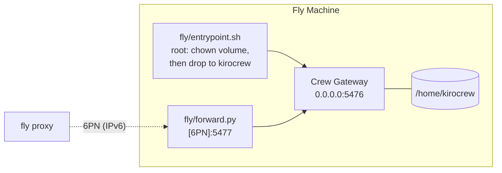

# Design

Why the repo looks the way it does.

## Inside the Machine

## Why a Dockerfile

The published image does not run on Fly as shipped.

| Problem | Cause | Fix |
|---|---|---|
| Gateway cannot write its home | Fly mounts the volume root-owned on every boot. The image runs as uid 1000. | `fly/entrypoint.sh` chowns the mount point, then drops to `kirocrew` |
| `fly proxy` cannot reach the gateway | Fly private networking is IPv6. The gateway binds one address, IPv4 by default. Binding `::` is IPv6-only and breaks `kirocrew token`, which dials `127.0.0.1`. | `fly/forward.py` relays `[6PN]:5477` to the gateway |

## Choices

- **Volume covers all of `/home/kirocrew`.** kiro-cli sign-in, `~/.kiro/agents` and `~/workplace` live outside `~/.kiro/crew`.
- **No `[http_service]`.** Nothing is public, and without Fly Proxy there is no auto-stop.
- **Relay on 5477, not 5476.** Crew has port-ownership logic keyed on its own port.
- **Relay dials the interface IPv4, not loopback.** Crew unlocks credential pages for loopback peers; a Fly private network is shared by the whole org. Set `CREWFLY_UPSTREAM=127.0.0.1` for loopback behavior.
- **`kill_signal = SIGTERM`.** Fly defaults to SIGINT.
- **`TINI_SUBREAPER=1`.** The image's `tini` is not PID 1 on Fly.
- **16 GB.** Agent sessions run on the gateway host. Upstream's floor.

## Webhooks

- `POST /api/hooks/agent` shares port 5476 with the dashboard, so a Fly service would expose both.
- Crew also rejects direct external POSTs: header-less requests are trusted only from loopback.
- Fix: a path-filtering reverse proxy in the Machine, behind a Fly `[http_service]`. Not built.

## Versus `kirocrew cloud launch` (EC2)

| | EC2 | Fly |
|---|---|---|
| Entry | One command, wizard | `./launch.sh` |
| Install | Source build, up to 25 min | Published image, about 15 s to start |
| Size | 8 vCPU / 32 GB default | 8 shared vCPU / 16 GB |
| Snapshots | No | 14 days |
| Inbound | None | None |
| Dashboard | SSM tunnel + token | `fly proxy` + token |
| Shows as "Remote Crew" locally | Yes | No |
| Upgrade | Relaunch, state lost | `fly deploy`, state kept |

## Not Sprites

Sprites stop when idle. The Gateway must not.
